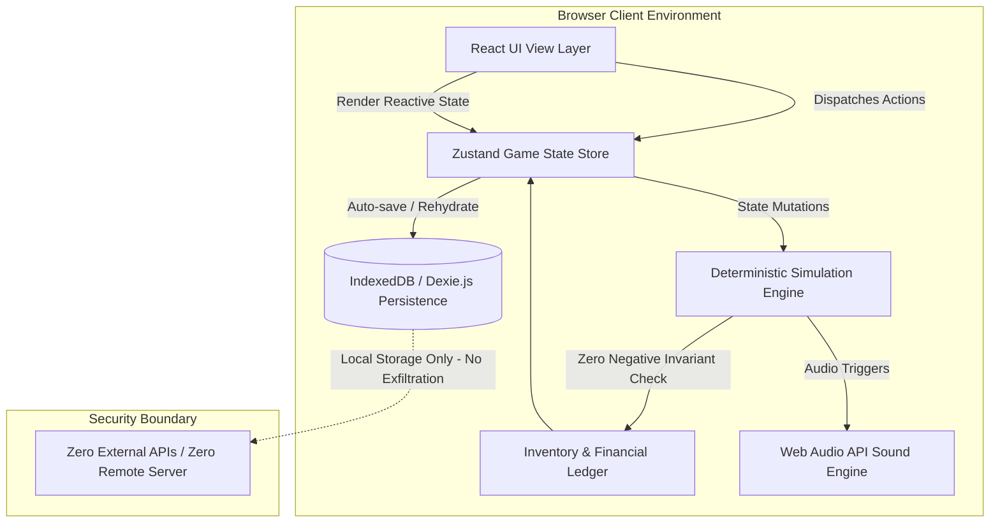
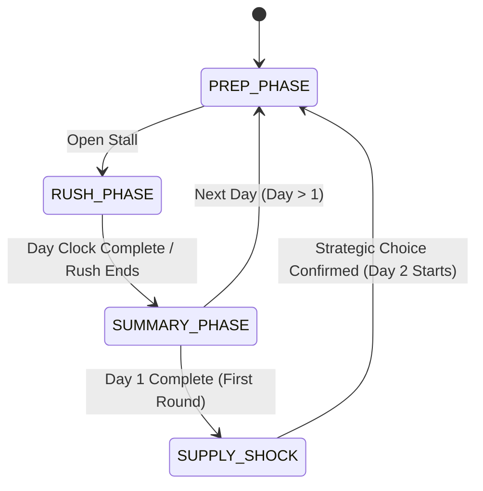

# Architectural Blueprint — Chai Tycoon

**Document Version:** 1.0.0  
**Target:** VibeSprint 1.0 (OWASP NIE)  
**Architecture Pattern:** Component-Driven Unidirectional State Machine with IndexedDB Persistence  

---

## 1. System Overview

Chai Tycoon is architected as an **offline-first, zero-external-dependency Single Page Application (SPA)** written in strict TypeScript. The architecture cleanly separates:
1. **Simulation Domain Logic:** Pure, deterministic functions calculating economics, recipe deductions, customer generation, and inventory validation.
2. **State & Persistence Layer:** Reactive Zustand stores synchronized with a browser-native IndexedDB database via Dexie.js.
3. **Presentation & Interaction Layer:** Accessible, modular React components styled with utility-first CSS and animated using procedural styling and CSS transitions.
4. **Procedural Synthesis Engine:** Real-time Web Audio API sound generator creating authentic boiling, pouring, and coin effects natively without audio asset network transfers.



---

## 2. Directory & Module Architecture

The project strictly follows the required directory layout:

```text
my-project/
├── frontend/
│   ├── src/
│   │   ├── components/
│   │   │   ├── common/            # ErrorBoundary, Modal, Toast, Button, Badge
│   │   │   ├── layout/            # Header, Navigation, StatusBar, WeatherWidget
│   │   │   ├── prep/              # MarketProcurement, PricingControls, InventoryTable
│   │   │   ├── rush/              # StallCanvas, KettleAnimation, CustomerQueue, OrderCard
│   │   │   ├── summary/           # DailyPnLBreakdown, CustomerSentiment, StarRating
│   │   │   ├── twist/             # SupplyShockModal, StrategyOptionCard
│   │   │   └── upgrades/          # UpgradeMarketCard, EquipmentTree
│   │   ├── engine/                # Pure TypeScript domain modules
│   │   │   ├── gameRules.ts       # Core game constants, default recipes, prices
│   │   │   ├── inventoryEngine.ts # Invariant validator (Zero-negative inventory)
│   │   │   ├── customerEngine.ts  # Archetype generation & patience formulas
│   │   │   ├── economyEngine.ts   # P&L, spoilage, dynamic pricing, rent
│   │   │   └── audioSynth.ts      # Web Audio procedural sound generation
│   │   ├── db/
│   │   │   └── database.ts        # Dexie.js database schema & historical records
│   │   ├── stores/
│   │   │   ├── useGameStore.ts    # Main state machine store
│   │   │   └── useAudioStore.ts   # Audio volume and mute control
│   │   ├── types/
│   │   │   └── index.ts           # Strict TypeScript interfaces & discriminated unions
│   │   ├── App.tsx
│   │   ├── main.tsx
│   │   └── index.css
│   ├── index.html
│   ├── package.json
│   ├── tsconfig.json
│   └── vite.config.ts
├── backend/
│   └── README.md                  # Manifest detailing zero-backend client-only design
├── docs/                          # Tracking & submission documentation suite
├── .gitignore
└── README.md                      # Root VibeSprint submission document
```

---

## 3. Data Schema & Persistence Layer

All game saves, historical day summaries, and player settings are stored in **IndexedDB** using **Dexie.js**.

### 3.1 Schema Definition
* **`gameState`**: Key-value table storing the current day, phase, cash, current inventory, active upgrades, recipe configs, and supply shock decision.
* **`daySummaries`**: Auto-incremented table containing historical ledger records for every completed day:
  * `dayNumber: number`
  * `revenue: number`
  * `cogs: number`
  * `rent: number`
  * `spoilage: number`
  * `netProfit: number`
  * `cupsSold: number`
  * `customersServed: number`
  * `customersLost: number`
  * `averageRating: number`
* **`customerFeedback`**: Log of customer dialogues, tips, and review sentiments.

---

## 4. Deterministic State Machine

The game runs as a finite state machine (FSM) transitioning through discrete phases:



### 4.1 Invariant Protection: Zero Negative Inventory
Every call to `brewAndServeOrder(orderId)` executes an atomic transaction check:

```typescript
function canFulfill(inventory: Inventory, required: Ingredients): boolean {
  return (
    inventory.milk >= required.milk &&
    inventory.teaLeaves >= required.teaLeaves &&
    inventory.sugar >= required.sugar &&
    inventory.ginger >= required.ginger &&
    inventory.cardamom >= required.cardamom &&
    inventory.cups >= required.cups
  );
}
```

If `canFulfill` returns false:
1. The action is rejected synchronously.
2. The UI flashes an "Out of Stock" notification.
3. No ingredient fields are decremented below zero.

---

## 5. Web Audio API Procedural Synthesis

To adhere strictly to the **Zero External APIs and Zero Asset Dependency** rules, sound effects are generated mathematically using the Web Audio API:
* **Boiling Bubble:** Modulated sine wave with brownian noise filtering.
* **Pouring Chai:** Band-pass filtered white noise with an envelope decay.
* **Coin Rattle:** Dual high-frequency square wave pings (987 Hz & 1318 Hz).
* **Warning Buzzer:** Low sawtooth wave (110 Hz).

---

## 6. OWASP Security Alignment

1. **Zero Attack Surface:** No remote server ports, API keys, or webhooks are exposed.
2. **Client-Side Sanitization:** All customer dialogues and logs use hardcoded template strings and React JSX escaping to prevent XSS.
3. **Data Integrity:** Strict TypeScript types prevent runtime schema corruption in IndexedDB.
