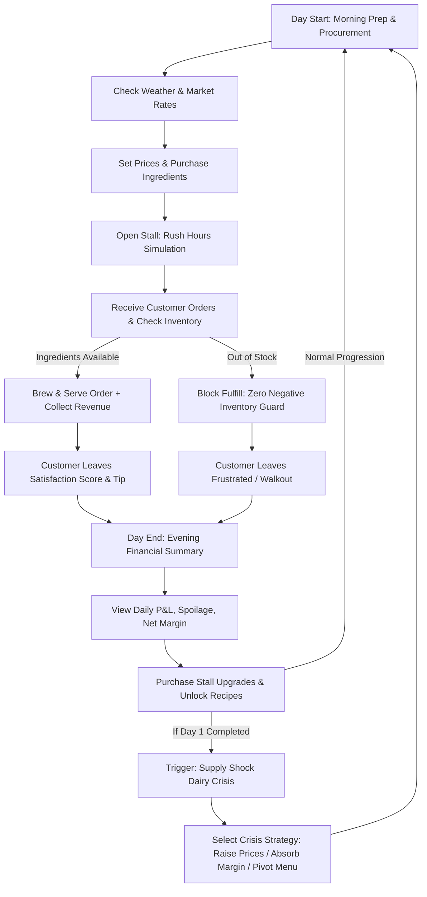

# Product Requirements Document (PRD) — Chai Tycoon

**Project Name:** Chai Tycoon  
**Event:** VibeSprint 1.0 — OWASP NIE  
**Author:** Principal Full-Stack Engineer  
**Status:** Approved & Architecture-Locked  
**Version:** 1.0.0  

---

## 1. Executive Summary
**Chai Tycoon** is an interactive, browser-native management and business simulation game that puts the player in the shoes of an Indian roadside Chai stall entrepreneur (*Chaiwala*). The player balances ingredient procurement, recipe crafting, customer patience, daily dynamic pricing, and stall upgrades across an iterative day-by-day progression loop.

Conforming strictly to **VibeSprint 1.0** standards, Chai Tycoon is engineered with **zero external APIs**, **zero .env dependencies**, **no third-party cloud backends or payment gateways**, and **100% browser-native persistence** via IndexedDB/LocalStorage.

---

## 2. Core Game Loop Architecture

### 2.1 Three-Phase Day Cycle
1. **Morning Prep & Procurement Phase:**
   - Review current day's weather forecast (Sunny, Monsoonal Downpour, Cold Winter Morning, Humid Afternoon) which directly shifts customer demand profiles.
   - Inspect raw material storage levels: Tea Leaves (g), Fresh Cow Milk (ml), White Sugar (g), Fresh Ginger (pcs), Green Cardamom (pods), and Kulhad Clay Cups (pcs).
   - Procure ingredients at fluctuating spot-market rates.
   - Adjust selling prices for catalog recipes with instant margin & elasticity calculations.

2. **Daytime Rush Simulation Phase:**
   - Open stall to a queue of diverse customer archetypes: *College Students, IT Techies, Local Elders/Uncles, and Morning Commuters*.
   - Dynamic customer patience meters that deplete in real-time.
   - Interactive boiling and serving controls (plus automatic assistant Chotu if unlocked).
   - Strict inventory guards preventing negative inventory.

3. **Evening Summary & Progression Phase:**
   - Financial ledger detailing Gross Revenue, Cost of Goods Sold (COGS), Spoilage/Wastage, Daily Stall Rent, and Net Profit.
   - Review sentiment log and overall stall reputation score (1 to 5 stars).
   - Upgrade Market: Buy equipment (Brass Samovar, Electric Burner, Clay Kulhad Bulk, Stall Decor, Hire Helper).

---

## 3. The Minute 40 Supply Shock Twist (Dairy Crisis)

### 3.1 Trigger Condition
Immediately following the completion of **Round 1 (Day 1)**, the simulation triggers an unskippable breaking news event: **"The Great Milk Supply Freeze"**.

### 3.2 Narrative & Market Shift
A sudden regional dairy transport strike doubles the procurement cost of fresh milk from **₹25/L to ₹50/L**.

### 3.3 Interactive Response Mechanism
The player is confronted with an interactive **Crisis Command Panel** offering three mutually exclusive strategic pathways:
1. **Strategy A: Pass Cost to Consumers (Raise Prices by +50%)**
   - *Mechanic:* Chai unit prices jump automatically.
   - *Impact:* Preserves unit profit margins, but price-sensitive archetypes (College Students) will walk out or complain; overall traffic drops by ~30%.
2. **Strategy B: Absorb the Shock (Maintain Flat Pricing)**
   - *Mechanic:* Absorb the doubled milk cost without raising cup prices.
   - *Impact:* Customer loyalty surges (+25% tip frequency, 5-star reviews), but gross margins plunge to razor-thin levels. Player must maintain high volume to survive daily rent.
3. **Strategy C: Reformulate & Pivot Menu (Low-Milk 'Sulaimani / Black Spiced' Chai)**
   - *Mechanic:* Unlock Kerala Sulaimani and Lemon Black Chai recipes requiring 0-20% milk and heavily spiced tea leaves.
   - *Impact:* Drastically cuts milk overhead, preserves profit, but requires educating traditional milky-chai drinkers.

---

## 4. Mathematical Determinism & Zero Negative Inventory Invariant

### 4.1 Invariant Formal Specification
Let $\mathcal{I} = \langle M, T, S, G, C, K \rangle$ represent the inventory vector of Milk, Tea, Sugar, Ginger, Cardamom, and Kulhad cups.
Let $\mathcal{R}_j$ represent the ingredient requirement vector for recipe $j$.

An order for item $j$ can be served if and only if:
$$\forall k \in \{M, T, S, G, C, K\}, \quad \mathcal{I}_k \ge \mathcal{R}_{j,k}$$

If the condition is violated:
- Serving is strictly prevented in the state machine (`canFulfillOrder === false`).
- The UI triggers an immediate "Out of Stock" alert and blocks order fulfillment.
- The inventory vector is guaranteed to satisfy:
$$\min(\mathcal{I}) \ge 0 \quad \text{at all simulation ticks.}$$

---

## 5. Non-Functional Requirements & VibeSprint Constraints

1. **Zero External APIs:**
   - No external fonts or CDN stylesheets; all typography, assets, and icons bundled locally.
   - Procedural Web Audio API sound effects for pouring, boiling, and register dings.
2. **Zero .env Dependency:**
   - Configuration is entirely self-contained in application code and local client storage.
3. **No Payment Gateway / No Cloud Backend:**
   - All progression, coins, and unlocks are simulated client-side.
4. **Accessible UI (A11y):**
   - WCAG AA compliant contrast ratios.
   - Full keyboard accessibility with intuitive hotkeys (`1-4` for quick serving, `Space` for brew).
   - Screen-reader friendly ARIA live status indicators.
5. **Robust State & Error Handling:**
   - React Error Boundary at root and component boundaries with graceful crash recovery and state rehydration.
